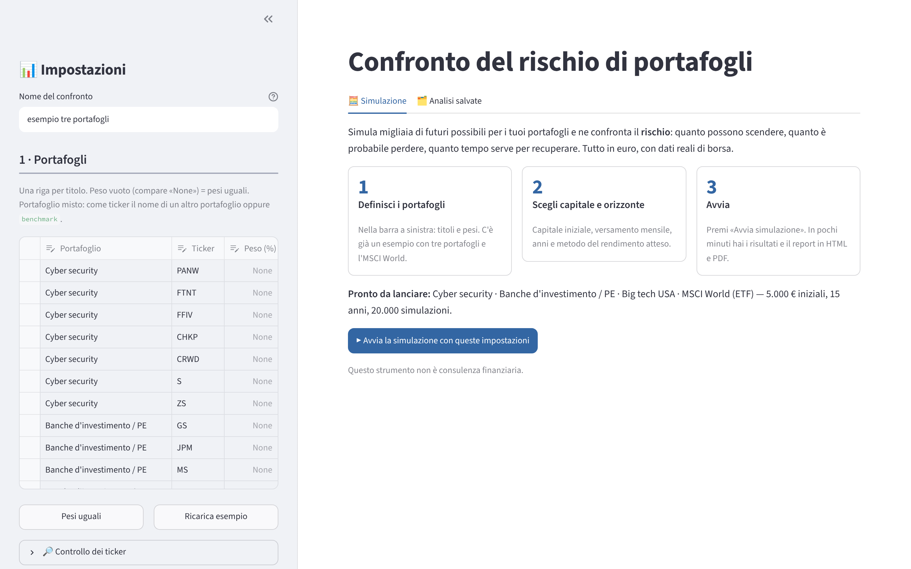
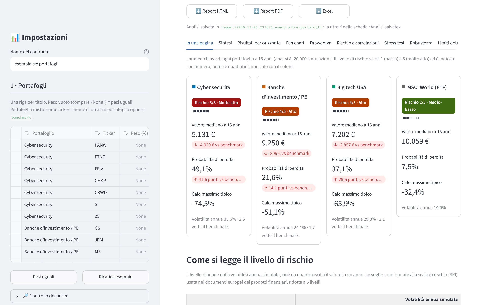
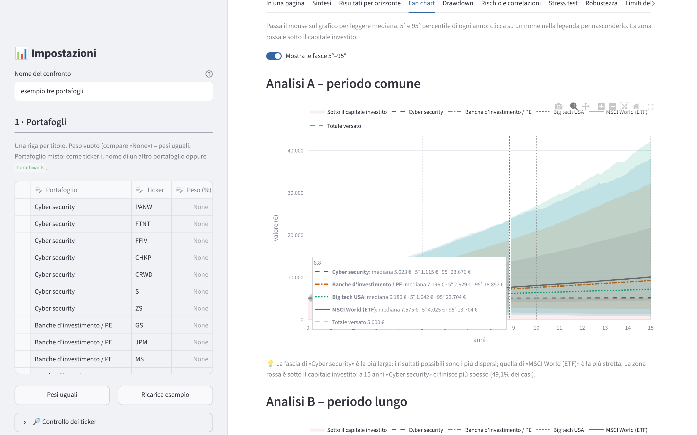

# Confronto del rischio di portafogli (Monte Carlo)

Uno strumento per confrontare il **rischio** di più portafogli di azioni ed ETF: simula migliaia di futuri possibili e ti dice quanto possono scendere, quanto è probabile finire sotto quanto hai investito e quanto tempo serve per recuperare. Funziona sul Mac con un doppio clic, senza saper programmare.

> **Non è consulenza finanziaria.** È un aiuto per capire i rischi, non un consiglio di acquisto.

| Pagina iniziale | «In una pagina» | Fan chart interattivo |
|---|---|---|
|  |  |  |

**Novità della versione 1.1:** dati più affidabili (più fonti, modalità offline, prezzi da file CSV, controllo dei ticker), report con copertina, indice e pagina «In una pagina» con il livello di rischio da 1 a 5, grafici interattivi, analisi salvate e confronto tra due analisi, prova rapida dei pesi, esportazione in Excel, calcolo in parallelo (circa 2 volte più veloce). Tutti i dettagli in `CHANGELOG.md`.

---

## 1. Scaricare il programma

**Metodo consigliato: lo zip della release.**
1. Apri la pagina del progetto su GitHub e clicca **Releases** (colonna di destra).
2. Nell'ultima versione (es. `v1.0.0`) clicca il file **`confronta-portafogli-v1.0.0.zip`**.

**In alternativa**: nella pagina principale del progetto clicca il pulsante verde **Code → Download ZIP**.

## 2. Dove metterlo

1. Apri la cartella **Download** e fai doppio clic sullo zip: si crea una cartella.
2. Spostala dove preferisci, ad esempio in **Documenti** (es. `Documenti/confronta-portafogli`).
3. Non metterla su iCloud Drive o in cartelle sincronizzate: l'installazione crea molti file.

## 3. Il primo avvio: l'avviso di sicurezza di macOS

La prima volta macOS blocca i file scaricati da internet ("non può essere aperto perché proviene da uno sviluppatore non identificato"). È normale.

1. Fai doppio clic su **`Installa.command`**: compare l'avviso. Premi **Fine** (o **OK**).
2. Apri **Impostazioni di Sistema → Privacy e sicurezza**.
3. Scorri in basso fino al messaggio su `Installa.command` e premi **Apri comunque**, poi conferma con la password del Mac.
4. Ripeti la stessa cosa la prima volta che apri `Avvia.command`.

**Se il doppio clic viene bloccato anche dopo "Apri comunque".** macOS mette un'etichetta invisibile, detta *quarantena*, su tutto quello che scarichi da internet, e a volte continua a bloccare i file anche dopo il permesso. Puoi togliere l'etichetta dalla cartella del programma con un solo comando:

1. Apri il **Terminale** (Launchpad → Altro → Terminale, oppure cerca "Terminale" con Spotlight ⌘+Spazio).
2. Scrivi questo comando, sostituendo `confronta-portafogli` con il nome della tua cartella dentro Documenti, e premi Invio:

```bash
xattr -dr com.apple.quarantine ~/Documents/confronta-portafogli
```

Il comando non stampa niente se va tutto bene. Toglie l'etichetta solo ai file di quella cartella e non cambia nient'altro sul Mac. Ora il doppio clic su `Installa.command` e `Avvia.command` funziona. Se la cartella non è in Documenti, scrivi `xattr -dr com.apple.quarantine ` (con lo spazio finale) e trascina la cartella nella finestra del Terminale: il percorso si scrive da solo.

## 4. Installare e avviare con il doppio clic

1. **Doppio clic su `Installa.command`.** Si apre il Terminale: lo strumento scarica Python e le librerie **dentro la cartella del programma** (non tocca il resto del Mac). Ci vogliono alcuni minuti e serve internet. Alla fine compare **"Installazione completata"**. Va fatto una volta sola.
2. **Doppio clic su `Avvia.command`.** Dopo qualche secondo si apre il browser con l'app.
3. **Per chiudere l'app** chiudi la finestra del Terminale.

Funziona sia sui Mac con chip Apple (M1, M2, M3, M4…) sia sui Mac Intel.

## 5. In alternativa: installazione manuale con Python

Se preferisci, installa Python 3.12 o 3.13 da [python.org](https://www.python.org/downloads/), poi apri il Terminale nella cartella del programma e scrivi:

```bash
python3 -m venv .venv
source .venv/bin/activate
pip install -r requirements.txt
streamlit run app.py
```

Le volte successive bastano:

```bash
source .venv/bin/activate
streamlit run app.py
```

## 6. Come usare l'app

Nella **barra a sinistra**:
- **Portafogli**: una riga per titolo con nome del portafoglio, ticker e peso. All'avvio trovi un esempio con tre portafogli (cyber security, banche d'investimento/PE, big tech USA).
  - I **ticker** si scrivono come su [finance.yahoo.com](https://finance.yahoo.com): `AAPL`, `ENI.MI` (Milano), `SAP.DE` (Francoforte), `ASML.AS` (Amsterdam), `MC.PA` (Parigi), `HSBA.L` (Londra), `NESN.SW` (Zurigo), ETF come `IWDA.AS`. Tutto viene convertito in euro.
  - **Peso in %**: lascialo vuoto (compare «None») per avere pesi uguali, oppure premi **Pesi uguali**. Se lo scrivi, i pesi di ogni portafoglio devono sommare a 100.
  - **Portafoglio misto**: nella colonna Ticker scrivi il nome di un altro portafoglio o la parola `benchmark`. Esempio "Satellite": riga `benchmark` con peso 80 e riga `Cyber security` con peso 20.
  - Per aggiungere una riga usa la riga vuota in fondo alla tabella; per toglierla selezionala e premi il cestino.
- **Capitale e orizzonte**: capitale iniziale, versamento mensile (anche 0), anni, orizzonti intermedi (es. `5, 10`).
- **Rendimento atteso**: scegli il metodo.
  - `beta` (consigliato): rendimento = 2% + beta × 4%. Chi si muove di più con il mercato rende di più in media.
  - `uguale`: stesso rendimento per tutti (es. 6%). Utile per confrontare solo il rischio.
  - `storico`: i rendimenti del passato. Attenzione: proietta il passato nel futuro ed è troppo ottimista se scegli titoli che sono già andati bene.
  - `personalizzato`: scegli tu il rendimento di ogni portafoglio.
- **Moduli**: stress test, rischio sul singolo titolo e «Le simulazioni bastano?» sono attivi. L'ultimo ripete il calcolo con 3 seed per controllare che il numero di simulazioni sia sufficiente. Il confronto tra modelli e l'analisi dal 1999 con proxy sono più lenti.
- **Numero di simulazioni**: il default è 20.000, così i risultati cambiano al massimo di circa ±2% tra un calcolo e l'altro. Le simulazioni girano in parallelo su più processori: con i moduli di default servono circa 1-2 minuti (misurato: 104 secondi sul Mac M1 a 3 core di GitHub; meno su un Mac recente). Per una prova veloce usa 1.000.
- Ogni opzione ha un'icona **?** con una breve spiegazione.
- Premi **▶ Avvia simulazione** (oppure il pulsante blu nella pagina iniziale). La barra mostra la fase in corso e il tempo stimato.

**Risultati**: compaiono in schede: **In una pagina** (una scheda per portafoglio con i numeri chiave e il livello di rischio da 1 a 5), Sintesi, Risultati per orizzonte, Fan chart, Drawdown, Rischio e correlazioni, Stress test, Robustezza, Limiti. Nel fan chart e nel grafico dei cali passa il mouse per leggere i valori di ogni anno, e clicca sui nomi della legenda per nascondere un portafoglio. In alto ci sono i pulsanti per scaricare il **report HTML** (si apre con il browser), il **PDF** (con copertina e indice cliccabile) e il file **Excel**.

**Prova rapida dei pesi**: nella scheda Sintesi un cursore mostra cosa succede mescolando il benchmark con un portafoglio satellite (es. 80% MSCI World + 20% cyber). È un calcolo veloce e approssimato: per i numeri definitivi crea il portafoglio misto e rilancia la simulazione.

**Analisi salvate**: ogni simulazione viene salvata da sola nella cartella `report/`. Nella scheda **🗂️ Analisi salvate** trovi l'elenco, puoi riaprire o scaricare un report e confrontare due analisi affiancate.

**Tema scuro**: menu **⋮** in alto a destra → **Settings** → **Theme**.

**Salva / carica configurazione**: in fondo alla barra laterale puoi scaricare le impostazioni correnti in un file `.yaml` e ricaricarle la volta dopo.

I prezzi scaricati restano nella cartella `cache_prezzi`, così le volte successive l'app è più veloce. Per avere i prezzi più recenti spunta **Aggiorna i dati**. La data dei dati è indicata in alto nei risultati e nel report ("Dati aggiornati al …").

### Da dove arrivano i dati
| Dato | Fonte principale | Fonti di riserva (automatiche) |
|---|---|---|
| Prezzi di azioni ed ETF | Yahoo Finance tramite la libreria `yfinance` (prezzi *adjusted*, dividendi inclusi) | 1) Yahoo Finance chiamato direttamente, senza `yfinance` (utile quando la libreria smette di funzionare); 2) **Stooq** (solo USA, Germania, Londra, Tokyo, Hong Kong; prezzi **senza dividendi**) |
| Cambi in euro | Yahoo Finance (`EURUSD=X`, …) | Yahoo diretto, **Banca Centrale Europea** (tassi di riferimento dal 1999), Stooq |
| Dollaro prima del 2003 | FRED (Federal Reserve) | Banca Centrale Europea |

Verifica fatta il 03/11/2026 su un Mac Apple Silicon (prova automatica su GitHub): Yahoo con `yfinance` e Yahoo diretto funzionano; la Banca Centrale Europea funziona; **Stooq al momento non restituisce dati** (resta come ultimo tentativo, costa mezzo secondo).
| Prezzi caricati a mano | il tuo file CSV | – |

Ogni fonte viene provata più volte con un'attesa crescente prima di passare alla successiva. Nel report, nella tabella "Titoli usati", c'è la fonte di ogni titolo. Lo script `python strumenti/verifica_fonti.py` mostra quali fonti rispondono dal tuo computer (la stessa prova gira anche nel test automatico su Mac).

**Senza internet**: se le fonti non rispondono ma i prezzi sono già in `cache_prezzi`, lo strumento usa quelli e lo scrive negli avvisi, con la data dell'ultimo aggiornamento.

### Caricare i prezzi da un file (se le fonti online non funzionano)
1. Scarica i prezzi a mano, ad esempio da finance.yahoo.com → pagina del titolo → **Historical Data** → **Download**, oppure da un altro sito.
2. Nell'app apri **📄 Carica prezzi da file**, scegli il file, scrivi il ticker con cui lo userai, la valuta e il tipo (azione o ETF), poi premi **Importa i prezzi**.
3. Usa quel ticker nella tabella dei portafogli. I prezzi caricati a mano non vengono mai sovrascritti dai download.

Formato del file: una colonna con la **data** (`GG/MM/AAAA` oppure `AAAA-MM-GG`) e una con il **prezzo** (meglio se *Adj Close*, cioè con i dividendi). Separatore `;` o `,`, decimali con la virgola o con il punto; le righe che iniziano con `#` sono ignorate. Esempio pronto: `esempi/prezzi_esempio.csv`. Dalla riga di comando si può fare lo stesso in configurazione:

```yaml
prezzi_da_file:
  MIOTITOLO: {file: esempi/prezzi_esempio.csv, valuta: EUR}
```

### Controllo dei ticker
Nella barra laterale, **🔎 Controllo dei ticker** mostra per ogni ticker il nome completo della società, la borsa, la valuta, gli anni di storia e la fonte. Serve ad accorgersi subito di un ticker sbagliato che punta a un'altra azienda. I ticker nuovi (fino a tre alla volta) vengono controllati appena li scrivi; per molti ticker nuovi c'è il pulsante **Scarica e controlla tutti i ticker**.

### Come leggere il report: glossario breve

| Termine | Significato |
|---|---|
| **Volatilità** | Quanto oscilla il valore in un anno. 30% = oscillazioni tipiche di ±30%. |
| **Max drawdown** | Il calo più grande da un massimo al minimo successivo. Da 10.000 a 4.000 € = −60%. |
| **Tempo sott'acqua** | Il periodo più lungo passato sotto il massimo precedente. |
| **Percentili** | Il 5° percentile è il valore sotto cui finisce il 5% dei casi peggiori; la mediana (50°) è il caso tipico; il 95° è il 5% dei casi migliori. |
| **VaR 95% a 1 anno** | La perdita che in un anno viene superata solo nel 5% dei casi. |
| **ES (Expected Shortfall)** | La perdita media in quel 5% di casi peggiori. |
| **Volatility drag** | Con le oscillazioni il risultato tipico resta sotto la media: perdere il 50% richiede un +100% per tornare in pari. Più un portafoglio oscilla, più la mediana resta indietro. |
| **Analisi A / B / C** | A: periodo in cui esistono tutti i titoli. B: periodo lungo, con i pesi ridistribuiti tra i titoli già quotati. C (facoltativa): dal 1999, con dati sintetici di settore per i titoli che non esistevano. |

## 7. Creare una configurazione a mano (file YAML)

Puoi anche lavorare senza app: copia `configurazioni/esempio_tre_portafogli.yaml`, rinominala (es. `configurazioni/mio_portafoglio.yaml`), modificala con TextEdit e lanciala dal Terminale:

```bash
source .venv/bin/activate
python confronta.py --config configurazioni/mio_portafoglio.yaml
```

Il report va in `report/AAAA-MM-GG_nome/`: `report.html`, `report.pdf`, la cartella `dati_csv` (tabelle per Excel) e la configurazione usata. Opzioni utili: `--veloce` (1.000 simulazioni), `--simulazioni 20000` e `--aggiorna-dati`.

Esempio commentato:

```yaml
nome: il mio confronto            # usato nel nome della cartella del report

capitale_iniziale: 10000          # euro investiti all'inizio
versamento_mensile: 200           # euro al mese (0 = nessuno)
orizzonte_anni: 20
orizzonti_intermedi: [5, 10]      # risultati anche a 5 e 10 anni

rendimento_atteso:
  metodo: beta                    # beta | uguale | storico | personalizzato
  tasso_privo_rischio: 0.02       # 0.02 = 2%
  premio_mercato: 0.04            # 0.04 = 4%
  # valore_uguale: 0.06           # per il metodo "uguale"
  # personalizzato:               # per il metodo "personalizzato"
  #   Europa dividendi: 0.05
  #   Satellite: 0.06
  #   benchmark: 0.06

n_simulazioni: 20000
ribilanciamento: annuale          # annuale | semestrale | trimestrale | mensile | mai

moduli:
  stress_test: true
  rischio_singolo_titolo: true
  confronto_modelli: false        # più lento
  analisi_C: false                # dal 1999 con proxy, più lento

portafogli:
  - nome: Europa dividendi
    titoli: [ENI.MI, ENEL.MI, ALV.DE, SAN.PA, NESN.SW]   # lista = pesi uguali
  - nome: USA qualità
    titoli: {MSFT: 30, JNJ: 25, PG: 25, KO: 20}         # pesi in % (somma 100)
  - nome: Satellite
    titoli: {benchmark: 80, USA qualità: 20}            # portafoglio misto

# Facoltativo: settore per gli stress test (tech | finanza | altro), se quello automatico non ti convince
# settori: {AMZN: tech}

# Facoltativo: costo annuo (TER) degli ETF usati come titoli. Se non lo indichi si usa ter_etf_default (0,20%).
# ter: {CSSPX.MI: 0.0007}
# ter_etf_default: 0.002

# Verifica "Le simulazioni bastano?" (attiva di default): ripete il calcolo con 3 seed diversi
# verifica_convergenza: {numero_seed: 3, soglia: 0.02}
```

Il benchmark di default è l'**iShares Core MSCI World** (`IWDA.AS`, TER 0,20%). Prima della sua nascita (2009) si usa l'indice MSCI World. Per cambiarlo aggiungi una sezione `benchmark:` come nel file di esempio.

## 8. Aggiornare a una nuova versione (ad esempio dalla 1.0 alla 1.1)

Le tue cose stanno in tre cartelle: `configurazioni/` (i file YAML), `cache_prezzi/` (i prezzi già scaricati) e `report/` (i report salvati). Il resto si può sostituire.

1. Scarica lo zip della nuova versione (punto 1) ed estrailo in una **nuova** cartella, ad esempio `Documenti/confronta-portafogli-v1.1.0`.
2. Copia dalla cartella vecchia a quella nuova:
   - i tuoi file da `configurazioni/` (non sovrascrivere gli esempi nuovi, se hanno lo stesso nome rinomina i tuoi);
   - l'intera cartella `cache_prezzi/` (così non riscarichi tutto);
   - l'intera cartella `report/` (i report della 1.0 restano leggibili; nella scheda «Analisi salvate» compaiono solo quelli creati con la 1.1, perché la 1.0 non salvava il file `riassunto.json`).
3. Se macOS blocca i file nuovi, vedi il punto 3 (anche il comando `xattr`).
4. Fai doppio clic su `Installa.command` nella nuova cartella (serve: la 1.1 usa due librerie in più), poi usa `Avvia.command`.
5. Quando tutto funziona puoi cancellare la cartella vecchia.

## 9. Problemi comuni

| Problema | Soluzione |
|---|---|
| "Non può essere aperto perché proviene da uno sviluppatore non identificato" | Vedi il punto 3: Impostazioni di Sistema → Privacy e sicurezza → **Apri comunque**. |
| Bloccato anche dopo "Apri comunque" | Nel Terminale: `xattr -dr com.apple.quarantine ~/Documents/confronta-portafogli` (vedi il punto 3). |
| Il doppio clic apre un editor di testo invece del Terminale | Clic destro sul file → **Apri con → Terminale**. |
| "Permission denied" su un file `.command` | Nel Terminale, dalla cartella del programma: `chmod +x Installa.command Avvia.command` |
| L'installazione si ferma con un errore di rete | Controlla internet e rilancia `Installa.command`: riparte da dove si era fermata. |
| "Il ticker «XYZ» non esiste" | Controlla il ticker su finance.yahoo.com, incluso il suffisso della borsa (`.MI`, `.DE`…). |
| "Il periodo comune a tutti i titoli è troppo breve" | Un titolo è quotato da meno di un anno: toglilo o sostituiscilo. |
| L'app non si apre nel browser | Guarda l'indirizzo scritto nel Terminale (es. `http://localhost:54321`) e copialo nel browser. |
| La simulazione è lenta | Riduci il numero di simulazioni o spegni "Confronto tra modelli" e "Analisi C". |
| Qualcosa non va dopo un aggiornamento di macOS | Cancella le cartelle `.venv`, `.python` e `.uv` e rilancia `Installa.command`. |
| I prezzi sembrano vecchi | Spunta **Aggiorna i dati** nell'app (oppure usa `--aggiorna-dati`). La data è scritta in alto: «Dati aggiornati al …». |
| «Nessuna fonte online risponde» | Riprova tra qualche minuto (Yahoo a volte limita gli accessi), oppure carica i prezzi da file (vedi «Caricare i prezzi da un file»). Se i prezzi erano già stati scaricati, lo strumento usa quelli e lo segnala. |
| «Si è verificato un errore imprevisto» | Mandami il file **`log.txt`** che trovi nella cartella del programma, insieme alla configurazione (pulsante «Scarica configurazione»). |
| Il calcolo in parallelo non parte | Nel file YAML scrivi `parallelo: no`: il calcolo è più lento ma i risultati sono identici. |

---

## Per chi pubblica il programma

### Ramo principale
Il codice di riferimento sta nel ramo **`main`**. Per renderlo il ramo predefinito (quello che si vede aprendo il repository e che usa **Code → Download ZIP**):
1. Sul sito di GitHub apri il repository e clicca **Settings** (in alto a destra, icona a ingranaggio).
2. Nel menu a sinistra clicca **General**; nella sezione **Default branch** premi il pulsante con le due frecce (⇄ *Switch to another branch*).
3. Scegli **`main`**, premi **Update** e conferma con **I understand, update the default branch**.

### Creare una release
1. Apri il repository e clicca **Releases → Draft a new release** (o **Create a new release**).
2. In **Choose a tag** scrivi il numero di versione (es. `v1.1.0`) e scegli **Create new tag … on publish**. In **Target** scegli **`main`**.
3. Titolo: ad esempio `v1.1.0`. Nella descrizione incolla il contenuto di `RELEASE_NOTES.md`.
4. Premi **Publish release**.
5. Dopo uno o due minuti la GitHub Action **"Zip per la release"** allega automaticamente `confronta-portafogli-v1.1.0.zip` alla release (puoi seguirla nella scheda **Actions**). Lo zip non contiene `.venv`, cache e report generati.

### Prova automatica su Mac
A ogni push, e su richiesta da **Actions → Prova su Mac → Run workflow**, GitHub esegue su un Mac Apple Silicon: installazione con `Installa.command`, test, un report di prova e l'avvio dell'app. L'esito (spunta verde o croce rossa) si vede nella scheda **Actions** e accanto all'ultimo commit; il report di prova si scarica dagli *Artifacts* dell'esecuzione.

## Struttura dei file

| File | Cosa fa |
|---|---|
| `app.py` | l'app (Streamlit) |
| `confronta.py` | lo stesso confronto da riga di comando |
| `configurazione.py` | lettura e controllo della configurazione YAML |
| `fonti.py` | fonti dei prezzi (Yahoo, Stooq, BCE), tentativi ripetuti, lettura dei CSV manuali |
| `dati.py` | cache dei prezzi, conversione in euro, settori, controllo dei ticker |
| `analisi.py` | rendimenti attesi, periodi A/B/C, esecuzione (anche in parallelo) dei moduli |
| `simula.py` | motore Monte Carlo (bootstrap a blocchi, Student-t, GARCH, crolli sul singolo titolo) |
| `metriche.py` | metriche e stress test |
| `report.py` | report HTML, PDF, Excel e CSV; analisi salvate |
| `grafici_app.py` | grafici interattivi dell'app (Plotly) |
| `stile.py` | colori e tratti fissi dei portafogli (uguali in app, report e PDF) |
| `registro.py` | file di log `log.txt` |
| `configurazioni/` | file di esempio (tre portafogli, core + satellite 80/20, ETF europei, prova automatica) |
| `esempi/` | report di esempio già pronti, verifica della convergenza, file di prezzi di esempio |
| `strumenti/` | `verifica_convergenza.py` (le simulazioni bastano?) e `verifica_fonti.py` (quali fonti rispondono) |
| `tests/` | test automatici (`python -m pytest -q tests`), compreso il test di non regressione |
| `docs/immagini/` | immagini del README |
| `CHANGELOG.md`, `STATO.md` | modifiche tra le versioni e note di sviluppo |

Per chi sviluppa: `pip install -r requirements-dev.txt`, poi `ruff check .` e `ruff format .`. Il test di non regressione (`tests/test_non_regressione.py`) controlla che 1.236 numeri chiave non cambino; si rigenera solo per una modifica voluta al calcolo con `python tests/non_regressione.py --aggiorna`.
